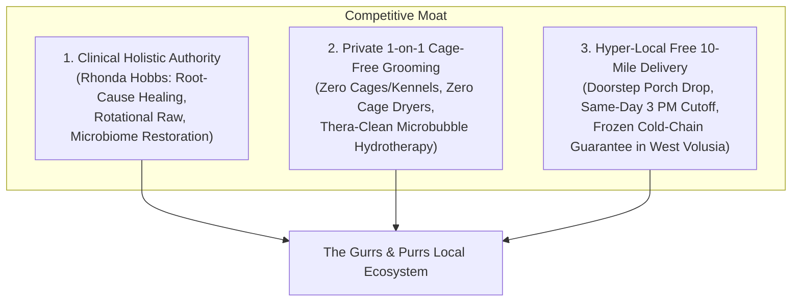
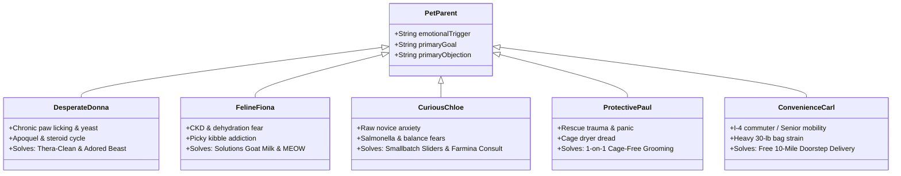
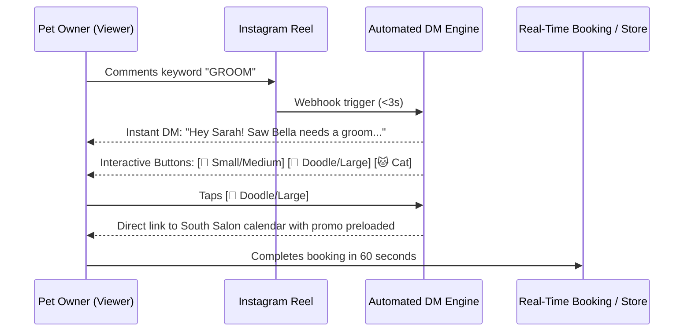
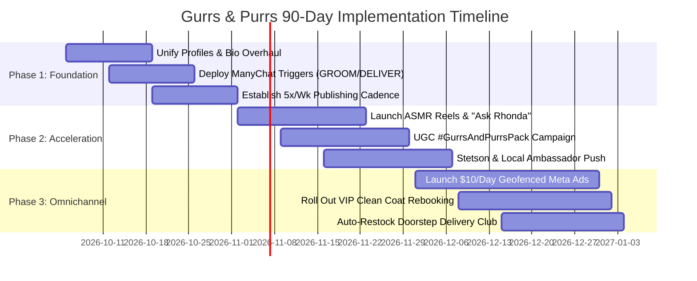
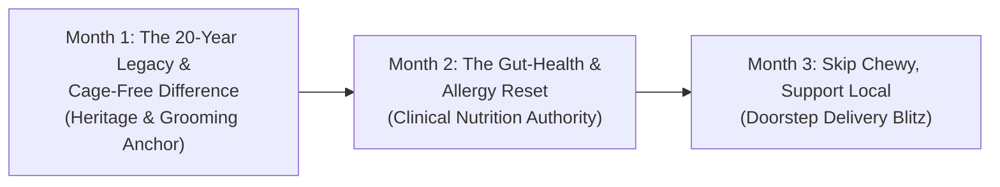
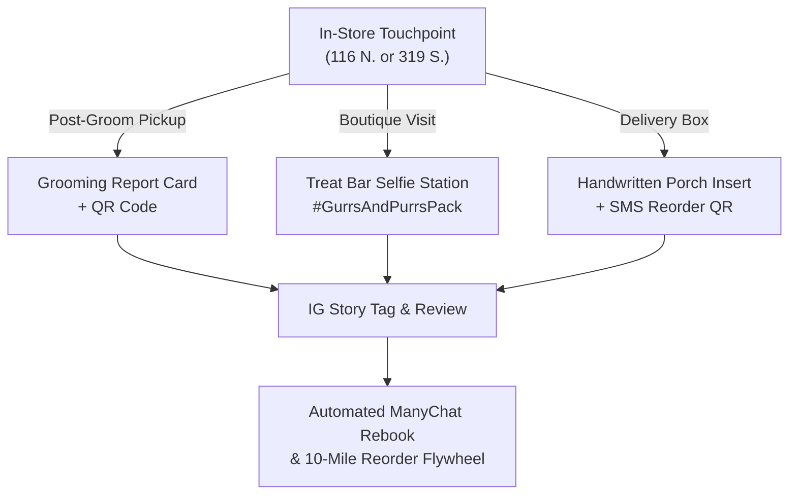

# Gurrs & Purrs: 360° Social Media Strategy & Post Architecture Master Plan

**Entity:** Gurrs & Purrs (DeLand, Volusia County, Florida)  
**Leadership:** Rhonda & Kelly Hobbs (Founded in 2006 — 20th Anniversary Milestone)  
**Operating Hubs:**  
* **Downtown Lifestyle Boutique & Nutrition Bar:** 116 N. Woodland Blvd, DeLand, FL 32720  
* **South Supercenter, 7-Freezer Raw Hub & 1-on-1 Cage-Free Grooming Salon:** 319 S. Woodland Blvd, DeLand, FL 32720  
**Prepared by:** Strategic Multi-Agent Swarm (Product & Audience Strategist, Post Architecture Specialist, Growth Campaign Architect)

---

## Executive Overview & Strategic Moat

For 20 years, Gurrs & Purrs has stood as Central Florida’s benchmark for holistic pet wellness. While mass-market chains (Petco, PetSmart) compete on commodity scale and e-commerce giants (Chewy, Amazon) compete on algorithmic delivery, **Gurrs & Purrs possesses an untouchable three-part competitive moat**:



The objective of this master strategy plan is to transform Gurrs & Purrs’ digital presence from an ad-hoc Facebook announcement page into a **high-converting, multi-channel customer acquisition and community advocacy engine**.

---

# SECTION 1: Master Product Catalog & Audience Segmentation

Gurrs & Purrs operates two strategically differentiated physical locations. Content must intentionally guide customers to the right hub for their needs:

```mermaid
graph LR
    subgraph 116 N. Woodland Blvd (Downtown Boutique)
        D1["Foot Traffic & Stetson Community"]
        D2["Curated Lifestyle & BayDog Gear"]
        D3["Bocce's Bakery & Treat Bar"]
        D4["Walk-In Nutritional Consults"]
    end
    
    subgraph 319 S. Woodland Blvd (South Supercenter)
        S1["7 Commercial Freezers (Raw Meat Hub)"]
        S2["Private 1-on-1 Cage-Free Grooming"]
        S3["Thera-Clean Microbubble Therapy"]
        S4["Free 10-Mile Delivery Dispatch"]
    end
```

### 1.1 Complete Product & Service Taxonomy

* **Frozen Raw Complete Diets (7-Freezer Hub at South Location):**
  * *Solutions Pet Products:* Regenerative agriculture, raw fermented dog/cat foods, fermented jowls/herrings, live microbial cultures without synthetic premixes.
  * *The Bones & Co.:* Ketogenic raw food (80% fat, 20% protein, <1% carbs) for cancer therapy, epilepsy, and metabolic healing.
  * *Smallbatch Pets:* Single-source antibiotic-free proteins with 100% certified organic produce.
  * *Big Country Raw, Raw Dynamic, OC Raw, Vital Essentials:* Butcher-cut complete prey-model grinds (80/10/10).
* **Freeze-Dried & Air-Dried Nutrition:**
  * *WOOF & MEOW (New Zealand Natural Pet Food Co.):* Wild Brushtail, Green-Lipped Mussel, Manuka Honey.
  * *The Simple Food Project & Dr. Marty:* Gently freeze-dried whole foods combining kibble convenience with raw bioavailability.
* **Gently Baked & Holistic Dry Food (Kibble):**
  * *Carna4:* Synthetic-free sprouted seed nutrition (sprouted organic barley, flax, lentils, peas) with live enzymes.
  * *Farmina N&D:* European ancestral grains and grain-free formulas paired with the Farmina Genius 5-checkpoint program.
  * *Canine Caviar & Feline Caviar:* The world's only alkaline holistic diet designed to reduce metabolic acidity and kidney stress.
  * *Fromm Family Pet Foods, Nature's Logic, Open Farm, SquarePet.*
* **Functional Supplements & Clinical Apothecary:**
  * *Adored Beast Apothecary:* The Leaky Gut Protocol, Fido’s Flora canine-species probiotic, Anti-Vaccinosis.
  * *Four Leaf Rover:* Soil-based probiotics (*Protect*), organic functional mushrooms, Bovine Colostrum.
  * *MycoDog:* Wild-crafted dual-extracted medicinal mushroom & adaptogen liquid tinctures.
  * *CBDDog Health (Angela Ardolino):* Medical-grade full-spectrum CBD oils and salves (*Calm*, *Ease*, *Heal*).
  * *Ultra Oil, CocoTherapy, UCARI Intolerance Test Kits, Yunnan Baiyao.*
* **Proprietary Services:**
  * *1-on-1 Crate-Free Grooming (South Location):* Private 60–90 minute appointments. Zero holding cages, zero box dryers, zero barking chaos.
  * *Thera-Clean® Microbubble Spa:* 3–20 micrometer negatively charged microbubbles that attract positively charged allergens, bacteria, and yeast from deep inside pores without soaps or chemicals.
  * *Free 10-Mile Delivery:* Dispatched daily within 10 miles of DeLand for all orders placed before 3:00 PM.

---

### 1.2 The 7 Core Buyer Personas & Product-to-Audience Mapping



#### Persona 1: The Allergy & Gut-Health Dog Parent ("Desperate Donna")
* **Pet Profile:** Frenchie, Doodle, Shepherd, or Pit Bull mix with inflamed paws, yeasty ears, and chronic skin flare-ups.
* **Core Pain Point:** Spent $2,000+ at the vet on Apoquel, Cytopoint, and prescription hydrolyzed corn/soy kibble. Symptoms return the moment pharmaceuticals stop.
* **Flagship Products:** Thera-Clean Microbubble Baths, Solutions Fermented Goat Milk, Carna4 Sprouted Seed, Adored Beast Leaky Gut Protocol, Ultra Oil.
* **Content Hook:** *"Stop suppressing your dog's allergies with $150 injections. Heal the gut that controls 80% of their immune system."*
* **Overcoming Objections:** Prove that spending $110/month on whole-food nutrition is cheaper than a single $400 emergency vet bill for ear infections and steroids.

#### Persona 2: The Picky & Obligate Carnivore Cat Parent ("Feline Fancier Fiona")
* **Pet Profile:** Domestic Shorthair or purebred cat with chronic dehydration, urinary crystals, hairballs, or kibble addiction.
* **Core Pain Point:** Terrified of feline kidney failure (CKD) or $2,500 urinary blockage surgeries. Guilt over feeding biological carnivores dry starch pellets.
* **Flagship Products:** MEOW New Zealand Freeze-Dried Raw, Smallbatch Cat Sliders, Solutions Fermented Cow Milk Kefir, Yeowww! Organic Catnip.
* **Content Hook:** *"Your cat isn't just picky. Their biology is rejecting dry food that contains zero moisture."*
* **Overcoming Objections:** The **Micro-Topper Transition Rule**—crush one freeze-dried meat nugget as flavor dust over current food; backed by Gurrs & Purrs' 100% taste guarantee.

#### Persona 3: The Holistic Raw Food Novice ("Curious Chloe")
* **Pet Profile:** Active puppy or young adult dog whose owner reads clean human ingredient labels.
* **Core Pain Point:** Overwhelmed by internet raw ratios (80/10/10), afraid of Salmonella, and worried about nutritional deficiencies.
* **Flagship Products:** Smallbatch Thaw-and-Serve Sliders, Bones & Co. Starter Patties, Farmina Genius Nutritional Consultations.
* **Content Hook:** *"Raw feeding doesn't mean butchering meat on your kitchen counter. Here's how to feed commercial raw in 60 seconds."*
* **Overcoming Objections:** Reassure with canine biology (dogs maintain an acidic stomach pH of 1–2) and USDA-inspected commercial brands using High-Pressure Processing (HPP).

#### Persona 4: The Holistic Raw Food Veteran ("Raw Veteran Ron")
* **Pet Profile:** Multiple working/sport dogs or chronic cancer/epilepsy patients needing strict ketogenic or rotational prey-model diets.
* **Core Pain Point:** Frustrated by online raw subscription services arriving thawed in the Florida heat or local stores stocking low-grade food.
* **Flagship Products:** 7 Freezers of bulk Cases (Solutions, Bones & Co., Raw Dynamic, OC Raw), whole duck heads, beef tracheas, Astro Loyalty Program.
* **Content Hook:** *"7 Commercial Freezers. 6 Elite Raw Brands. Zero Thawed Mail-Order Shipments. Central Florida’s Raw Meat Headquarters."*
* **Overcoming Objections:** Cold-chain guarantee right in DeLand, plus Astro Loyalty (Buy 10/12, Get 1 Free) beats online pricing.

#### Persona 5: The Anxious / Traumatized Rescue Dog Owner ("Protective Paul")
* **Pet Profile:** Rescue dog with noise sensitivity, kennel trauma, or past grooming abuse.
* **Core Pain Point:** Dog returned from corporate salon shaking and panicked after being locked in a metal drying cage for 4 hours.
* **Flagship Products:** Private 1-on-1 Crate-Free Grooming at 319 S. Woodland Blvd, CBDDog Health *Calm* Tincture, Woof Pupsicle.
* **Content Hook:** *"No metal cages. No barking chaos. No cage dryers. What 1-on-1 private grooming actually looks like."*
* **Overcoming Objections:** Offer a free 10-minute "Happy Visit" where the dog walks into the salon, eats treats, meets the groomer, and leaves without being touched.

#### Persona 6: The Boutique Pampered Pet Enthusiast ("Chic Courtney")
* **Pet Profile:** Pampered Doodle, Pomeranian, or Frenchie treated like a child.
* **Core Pain Point:** Mass-market pet stores are industrial warehouses with cheap plastic gear and ugly collars.
* **Flagship Products:** BayDog Coastal Leashes/Harnesses, Bocce’s Bakery Biscuits, dog birthday celebration cakes, Downtown Boutique accessories.
* **Content Hook:** *"Treat your best friend to the ultimate Downtown DeLand shopping spree."*
* **Overcoming Objections:** Highlight that boutique items are made from ballistic nylon, rust-proof hardware, and human-grade USA ingredients that outlast big-box cheap plastic.

#### Persona 7: The Busy Commuter & Senior Resident ("Convenience Carl & Senior Sara")
* **Pet Profile:** Family dog or companion animal; household constrained by time (Carl commuting on I-4) or physical mobility (Sara with arthritis).
* **Core Pain Point:** Inability to haul 30–40 lb bags of Fromm or Carna4 from a car trunk into the house.
* **Flagship Products:** Free 10-Mile Doorstep Home Delivery, Fromm Gold, Carna4, Sustainably Yours heavy cassava cat litter.
* **Content Hook:** *"Why drag 30-pound dog food bags through parking lots? We deliver the healthiest pet food to your porch—for FREE."*
* **Overcoming Objections:** Zero delivery fees, cold-insulated bags for raw/frozen items, and friendly phone-ordering for seniors.

---

# SECTION 2: Post-by-Post Engineering & Diagnostic Blueprint

Top-performing pet retailers operate as micro-media studios. Every single short-form video (Reel / TikTok / Short) must adhere to the **6-Component Post Anatomy**:

```
[0.0s - 3.0s]  TRIPLE-HOOK SYSTEM (Visual Movement + Verbal Hook + On-Screen Text)
      │
[3.0s - 25.0s] STORYLINE ARCHITECTURE (PAS / 3-Act Grooming / ASMR Sensory)
      │
[AUDIO BED]    TRI-LAYER SOUND (Voiceover @ -6dB | Foley ASMR @ -12dB | Bed Music @ -24dB)
      │
[METADATA]     LOCALIZED SEO (DeLand/Volusia Geotag + 4-5 Semantic Tags + Descriptive Alt-Text)
      │
[CAPTION]      5-STAGE COPY (Hook Line -> Value Drop -> Local Context -> Question -> CTA)
      │
[CONVERSION]   FRICTIONLESS DM PIPELINE (Comment Trigger -> Instant ManyChat DM -> Checkout)
```

### 2.1 The Triple-Hook System (0.0s – 3.0s)
Viewers decide whether to skip in **400 milliseconds**. If skip rate exceeds 40%, the algorithm halts distribution.
1. **Visual Hook:** Begin *in media res* with high physical motion or contrast. (e.g., scissors snipping through a dense pelt; macro shot of raw goat milk splashing over beef liver; high-velocity dryer blowing loose undercoat off a dog).
2. **Verbal Hook (< 1.2s):** *"If your dog’s paws smell like corn chips, stop scrolling right now."* or *"Bella’s owner was told she’d have to be shaved bald today... here’s what we did instead."*
3. **On-Screen Text:** Bounded within the **upper-middle 40%** of the screen in high-contrast bold font (yellow on black or white on dark green), max 8–10 words.

### 2.2 Tri-Layer Audio Strategy
* **Track 1: Primary Voiceover (-6 dB to -8 dB):** Close-mic directional lavaliere (DJI Mic 2), crisp, warm, compressed.
* **Track 2: Diegetic ASMR Foley (-12 dB to -15 dB):** Real grooming/eating sounds (scissors snipping, water spray, kibble crunch, dog panting).
* **Track 3: Trending Audio (-22 dB to -26 dB):** Trending Instagram/TikTok audio track with **auto-ducking** (-12dB) activated whenever the voiceover speaks.

### 2.3 Frictionless Conversion Pipeline: Comment-to-DM Automation
Traditional "Link-in-Bio" generates an anemic **0.8%–1.5% CTR**. In contrast, automated **Comment-to-DM triggers (ManyChat)** convert at **25%–45% CTR** with an **85%+ open rate**:



---

### 2.4 The 100-Point Post Diagnostic Rubric

Evaluate every published post at **24 hours** and **72 hours**:

| Dimension | Target Metric | Weight | Diagnostic Action if Failing |
| :--- | :--- | :--- | :--- |
| **1. Hook Rate (3s Views / Impress.)** | **> 38.0%** | 25 Pts | If <20%, scrap the first 2 seconds; re-edit with high-motion macro visual. |
| **2. 15-Second Retention Rate** | **> 45.0%** | 20 Pts | If sharp drop at 5s, the body failed to deliver on the hook's curiosity promise. |
| **3. Save-to-Reach Ratio** | **> 2.5%** (3.5% for Nutrition) | 15 Pts | If low, post lacked practical utility (recipes, ingredient guides, checklists). |
| **4. Share-to-Like Ratio** | **> 0.35** | 15 Pts | If <0.10, post is passive entertainment; add relatable pet parent humor or urgent local warnings. |
| **5. Inbound DM Trigger Rate** | **> 1.2% of Reach** | 15 Pts | If low, make CTA friction-free (e.g., "Comment PAWS" instead of "Visit our website"). |
| **6. Local Reach Ratio (Volusia/FL)** | **> 40.0%** | 10 Pts | If low, diversify geotags to Victoria Park, Lake Helen, Stetson, and Downtown DeLand. |
| **TOTAL COMPOSITE SCORE** | **Target: > 80 / 100** | **100 Pts** | Posts scoring >85/100 qualify for $5/day local paid ad boosting. |

---

### 2.5 Concrete Post Autopsies: Winner vs. Flop

#### Autopsy A: The Grooming Transformation (South Location)
* **The Winner (Score: 95/100):**
  * *Hook (0–3s):* Extreme macro close-up of scissors parting a felted mat behind a Doodle's ear. Text: *"Her owners were told she HAD to be shaved bald... 🥺"*
  * *Storyline (3–18s):* 1.8-second rapid cuts: Thera-Clean hydrotherapy massage -> high-velocity undercoat blowout -> hand-scissoring teddy-bear face.
  * *Reveal (18–24s):* Happy dog strutting in sunshine with lavender bandana. VO explains why cage-free handling prevents panic.
  * *CTA:* *"Comment 'DOODLE' for our coat recovery routine + priority booking link!"*
  * *Results:* 142k Reach, 54% Hook Rate, 412 DMs, **84 booked appointments ($7,140 revenue)**.
* **The Flop (Score: 24/100):**
  * *Hook (0–3s):* Blurry, static wide shot of a dog standing nervously on a table under fluorescent lights. Text: *"Max got a haircut today!"*
  * *Storyline (3–28s):* 25 seconds of the camera circling the table while royalty-free ukulele music blares. No bath, no cutting action, no payoff.
  * *CTA:* *"Call 386-555-XXXX to book."*
  * *Results:* 620 impressions, 14% Hook Rate, 0 calls, 0 bookings.

#### Autopsy B: The Holistic Food / Allergy Tip (Downtown Boutique)
* **The Winner (Score: 96/100):**
  * *Hook (0–3s):* Dog aggressively chewing red paw; audio cut of raw egg cracking into bowl. Text: *"STOP letting your dog lick their paws like this! 🛑"*
  * *Storyline (3–19s):* Rhonda explains how Florida humidity and high-starch kibble fuel systemic yeast. ASMR bowl build: Carna4 + raw goat milk + kelp topper.
  * *Reveal (19–27s):* Dog licking bowl clean in 15 seconds. Side-by-side infographic of yeasty paws vs. healthy pink skin.
  * *CTA:* *"Comment 'YEAST' to get Rhonda's 7-Day Gut Reset Guide + store coupon!"*
  * *Results:* 94k Reach, 5,120 Saves, 1,120 DMs sent, **248 in-store coupon redemptions ($5,840 retail revenue)**.
* **The Flop (Score: 21/100):**
  * *Hook (0–3s):* Owner standing in front of freezer doors waving awkwardly with glare on glass.
  * *Storyline (3–22s):* Camera pans quickly across freezer bags with unreadable labels. Echoey audio without a microphone: *"Uh, we have raw food... come visit."*
  * *CTA:* None.
  * *Results:* 430 impressions, 16% Hook Rate, 2 saves, $0 revenue.

---

# SECTION 3: 90-Day Strategic Campaign Roadmap



### Phase 1 (Days 1–30): Foundation, Unification & Tech Infrastructure
* **Bio & Highlight Overhaul:** Clearly delineate both addresses:
  * 📍 *116 N. Woodland: Holistic Nutrition & Lifestyle Boutique*
  * 🛁 *319 S. Woodland: Stress-Free, Cage-Free Grooming & 7-Freezer Raw Hub*
  * 🚚 *FREE 10-Mile Doorstep Delivery in West Volusia*
* **ManyChat Conversational Triggers:** Activate `GROOM`, `DELIVER`, `YEAST`, and `ALLERGY`.
* **Cross-Post to Google Business Profiles:** Automatically sync weekly video updates and store hours to both verified Google map locations to capture incoming DeLand movers.

### Phase 2 (Days 31–60): Video Acceleration & UGC Activation
* **Short-Form Video Production Sprint:**
  * *The ASMR Cage-Free Groom (South):* Soft lighting, gentle brushing, lathering natural herbal shampoos, zero cage noise.
  * *What $50 Gets You at Gurrs & Purrs vs. Chewy:* Side-by-side comparison illustrating free doorstep delivery, human consultation with Rhonda, and unadulterated high-protein treats.
* **The #GurrsAndPurrsPack UGC Engine:**
  * In-store photo station at both locations. Customers tag `@gurrspurrs` with their purchase or fresh haircut for entry into a monthly $50 gift card drawing.
* **Stetson & Downtown Ambassador Program:**
  * Partner with 5 local pet parents (Stetson faculty/students, downtown merchants) with "Gurrs & Purrs Welcome Crates" in exchange for authentic doorstep delivery unboxing Reels.

### Phase 3 (Days 61–90): Omnichannel Conversion & Local Paid Amplification
* **Hyper-Local Meta Ad Funnels ($10/Day Budget within 10 Miles):**
  * *Ad Campaign A (Grooming Lead Gen):* Video tour of 319 S. Woodland. Hook: *"Does your dog tremble at the groomer? Discover 1-on-1 cage-free grooming in DeLand."* Click-to-DM trigger.
  * *Ad Campaign B (Doorstep Delivery Acquisition):* Reel showing local order packed and delivered to a Victoria Park porch. Hook: *"Stop hauling heavy kibble bags. Free 10-mile delivery in DeLand."* Offer: Code `DELANDFREE` for $5 off.
* **VIP Retention Clubs:**
  * **"6-Week Clean Coat Club":** Automated ManyChat/SMS reminder sequences prompting grooming rebookings at week 4.
  * **"Rhonda’s Auto-Restock Club":** Scheduled Tuesday/Thursday doorstep replenishment for raw goat milk, Carna4, and dental chews.

---

# SECTION 4: Three Deep-Dive Monthly Thematic Campaigns



### Month 1: "The 20-Year Legacy & The Cage-Free Difference"
* **Cultural Narrative:** For 20 years, Rhonda and Kelly Hobbs have treated DeLand’s pets as family. With hundreds of new families moving into Victoria Park and Deltona, Month 1 educates pet parents on why traditional commercial grooming cages are hazardous and unveils the gentle sanctuary at 319 S. Woodland.
* **Key Content Executions:**
  1. *Founder Video:* "Why We Built a Cage-Free Salon 20 Years Ago" (Rhonda walking through the salon, soothing an elderly dog on an orthopedic bed).
  2. *Location Clarifier Carousel:* Side-by-side slide guide: Downtown Boutique (116 N) vs. South Supercenter (319 S).
  3. *Thera-Clean Microbubble ASMR Reel:* Macro footage of tiny negatively charged microbubbles lifting skin debris without soaps.
* **Promotional Offer:** First-time South salon clients receive a complimentary blueberry facial and a free 4oz sample of freeze-dried raw treats from the Downtown boutique (`CAGEFREEFIRST`).

### Month 2: "The Gut-Health & Allergy Reset" (Spring/Summer Relief)
* **Cultural Narrative:** Central Florida humidity triggers a wave of red paws, ear infections, and hot spots. Rather than masking symptoms with veterinary steroids, Month 2 positions Rhonda Hobbs as the functional health detective who heals allergies from the inside out.
* **Key Content Executions:**
  1. *Educational Reel:* "Stop Blaming the Grass: Rhonda’s 3-Step Allergy Reset" (Starch fuels yeast -> add raw goat milk -> introduce anti-inflammatory omega-3s).
  2. *Comparison Carousel:* "Kibble vs. Gently Cooked vs. Raw: What's the Real Difference?" (Moisture content, live enzymes, bioavailability).
  3. *Live Q&A with Rhonda:* Instagram & Facebook Live addressing real-time allergy questions submitted via Story question stickers.
* **Promotional Offer:** "Allergy Reset Bundle": Buy any freeze-dried or raw base food, get fermented raw goat milk at 50% off + free 15-minute nutritional consultation at 116 N. Woodland.

### Month 3: "Skip Chewy, Support Local — Doorstep Delivery Month"
* **Cultural Narrative:** Pet owners default to Chewy out of habit, but e-commerce shipments sit in hot trucks, arrive with crushed bags, and drain money from the local economy. Month 3 proves that Gurrs & Purrs’ **Free 10-Mile Doorstep Delivery** is faster, personal, and price-competitive.
* **Key Content Executions:**
  1. *Side-by-Side Reel:* Chewy (impersonal brown box tossed on driveway in rain) vs. Gurrs & Purrs (Rhonda packing fresh raw food with a handwritten note and delivering to a DeLand porch).
  2. *POV Delivery Driver Vlog:* Morning van loading at South location -> Stop 1 in Downtown -> Stop 2 in Victoria Park -> Stop 3 in Orange City.
  3. *Testimonial Carousel:* Screenshots of verified customer reviews praising delivery speed and advice.
* **Promotional Offer:** "Switch & Save Challenge": Show a screenshot of your active Chewy/Amazon pet food subscription; Gurrs & Purrs matches the price + gives **$10 off your first delivery order** of $40 or more (`SWITCH`).

---

# SECTION 5: Physical-to-Digital (O2O) Integration & Daily SOP

Momentum accelerates when in-store physical touchpoints feed social media channels:



1. **Grooming Report Cards (319 S. Woodland):** Handed to every owner at pickup. Detailed report on coat, skin, and ears on the front; QR code on the back: *"Loved Max's stress-free groom? Tag @gurrspurrs on Instagram & scan to lock in your 5-week rebooking!"*
2. **Treat Bar Selfie Station (Both Locations):** Wooden backdrop: *"Certified Good Boy / Girl of DeLand - @gurrspurrs"*. Tagging the store enters the owner into the monthly $50 shopping spree.
3. **Delivery Bag Inserts:** Eco-friendly postcard: *"Hand-packed with love in DeLand, FL for [Pet Name]! Running low? Text or DM 'REORDER' to this number for next week's route."*

---

### The 15-Minute Daily Content Capture SOP

Busy retail and salon staff do not have hours for content creation. Follow this predictable 15-minute daily cadence:

| Time Slot | Action | Logistics & Tooling |
| :--- | :--- | :--- |
| **8:45 AM (5 Mins)** | **The Morning Capture** | Mount phone/mic on South grooming station. Capture 3 high-motion B-roll clips (60fps 4K): shear snip, microbubble lather, dryer blowout. |
| **1:15 PM (5 Mins)** | **The Pantry Punch** | Place wooden board on Downtown counter. Record 10-second top-down ASMR bowl build (crack egg, pour goat milk, drop freeze-dried topper). |
| **4:30 PM (5 Mins)** | **Edit & Launch** | Drop clips into CapCut template. Record 15-second voiceover. Apply auto-captions. Deploy with pre-written ManyChat keyword trigger. |

---

## 90-Day Target Executive Scorecard

| Funnel Dimension | Metric Tracked | Baseline | Day 30 Target | Day 60 Target | Day 90 Target |
| :--- | :--- | :--- | :--- | :--- | :--- |
| **Awareness** | Non-Follower Local Reach | ~8,500 | 18,000 | 32,000 | **50,000+** |
| **Authority** | Saves & Shares per Post | 12 saves / 8 shares | 35 saves / 25 shares | 60 saves / 45 shares | **100+ saves / 75+ shares** |
| **Community** | Monthly Tagged UGC Stories | < 5 / month | 25 / month | 60 / month | **120+ / month** |
| **Direct Bookings**| Grooming Inquiries / Week | 8 / week | 18 / week | 28 / week | **40+ / week (Full Books)** |
| **Local Delivery**| Doorstep Delivery Orders | 10 / week | 25 / week | 45 / week | **75+ / week** |
| **Customer LTV** | 6-Week Grooming Rebook Rate | ~40% | 52% | 65% | **75%+** |

By unifying physical operations with automated digital pipelines, Gurrs & Purrs will transform its 20-year local legacy into Central Florida’s most profitable and engaged independent pet brand.
