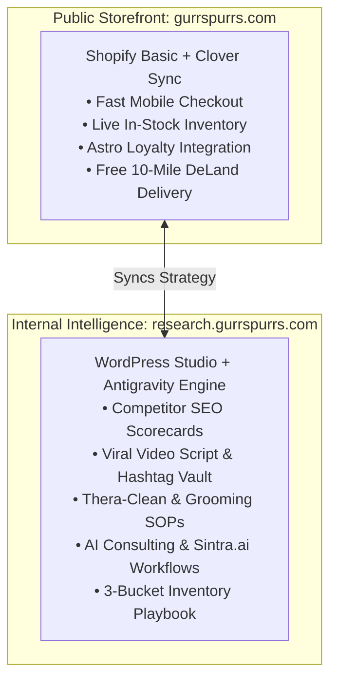

# WordPress Studio & Antigravity Hand-Off Instructions
## Subdomain Intelligence Hub: `research.gurrspurrs.com`
**Client:** Gurrs & Purrs (DeLand, FL)  
**Principals:** Rhonda Hobbs & Kelly Hobbs  
**Environment:** WordPress Studio (`/Users/macstudio/.local/bin/studio`) + Antigravity AI Agent  
**Subdomain Target:** `research.gurrspurrs.com` (Staged locally at `research.gurrspurrs.local`)  
**Date:** October 3, 2026  

---

## 1. Executive Architecture & Strategic Purpose

To scale Gurrs & Purrs into the undisputed regional leader for holistic pet nutrition and cage-free grooming, we deploy a **dual-architecture web ecosystem**:



### Why a Dedicated Subdomain?
1. **Separation of Concerns:** Keep the public e-commerce store (`gurrspurrs.com`) lightweight, lightning-fast, and strictly sales-focused. 
2. **Defensible Trade Secrets:** The deep research (Chewy immunity margins, competitor vulnerability audits, supplier wholesale pricing, and raw feeding protocols) is proprietary intellectual property. It must be hosted on a **secure, password-protected team subdomain** (`research.gurrspurrs.com`).
3. **Living Knowledge Base:** Instead of static PDFs buried in email attachments, Rhonda, Kelly, and store managers have a live, mobile-friendly dashboard accessible on iPads in the shop or phones on the grooming floor.

---

## 2. WordPress Studio & Antigravity AI Engine

This Mac Studio is equipped with **WordPress Studio CLI** (`/Users/macstudio/.local/bin/studio`), Automattic's modern WordPress development platform. When paired with **Antigravity**, it creates an autonomous development and publishing pipeline.

```
┌────────────────────────────────────────────────────────────────────────┐
│                   ANTIGRAVITY AI AGENT (THIS RUNTIME)                  │
│  • Researches competitor data and writes video scripts                 │
│  • Generates custom Block Themes and responsive HTML templates        │
│  • Controls WordPress Studio via MCP (Model Context Protocol) & CLI    │
└──────────────────────────────────┬─────────────────────────────────────┘
                                   │ Commands & Sync
┌──────────────────────────────────▼─────────────────────────────────────┐
│                 WORDPRESS STUDIO LOCAL RUNTIME                         │
│  • Local Site: ~/Studio/gurrs-and-purrs-research                       │
│  • Native PHP 8.4 + SQLite / MariaDB engine                            │
│  • Instant Cloud Previews: 'studio preview create'                     │
│  • One-Click Production Deploy: 'studio push'                          │
└──────────────────────────────────┬─────────────────────────────────────┘
                                   │ Production Push
┌──────────────────────────────────▼─────────────────────────────────────┐
│              LIVE SUBDOMAIN: research.gurrspurrs.com                    │
│  • Password-protected internal portal for Rhonda, Kelly & team         │
└────────────────────────────────────────────────────────────────────────┘
```

---

## 3. Step-by-Step Local Setup & Verification

### Step 3.1: Local Site Initialization
The site is created in the local Studio directory using the Studio CLI:
```bash
/Users/macstudio/.local/bin/studio create \
  --name "Gurrs & Purrs Research Hub" \
  --path /Users/macstudio/Studio/gurrs-and-purrs-research \
  --domain research.gurrspurrs.local \
  --php 8.4 \
  --start \
  --skip-browser
```

### Step 3.2: Verify Site Status & Active Credentials
The local site has been created and is currently online:
```bash
/Users/macstudio/.local/bin/studio list
```
* **Local Site URL:** `http://research.gurrspurrs.local`
* **Interactive Portal URL:** `http://research.gurrspurrs.local/portal.html`
* **1-Click Admin Auto-Login:** `http://research.gurrspurrs.local/studio-auto-login?redirect_to=%2Fwp-admin%2F`
* **Admin Username:** `admin`
* **Admin Password:** `Ey(9e19lYjBtkrOcx8(1^(l!`
* **Local Path:** `/Users/macstudio/Studio/gurrs-and-purrs-research`
* **PHP Runtime:** Native PHP 8.4 | **WordPress Version:** 7.1.2

### Step 3.3: Launching the Studio Web UI
To open the graphical Studio manager in your default browser:
```bash
/Users/macstudio/.local/bin/studio ui
```

---

## 4. Model Context Protocol (MCP) Integration for Antigravity

WordPress Studio includes an integrated MCP server that allows Antigravity (and peer assistants like Claude/Codex) to programmatically edit themes, install plugins, create posts, and inspect database state.

### MCP Configuration
To equip AI assistants with direct control over WordPress Studio, verify the MCP configuration in `~/.cursor/mcp.json` or your agent config:

```json
{
  "mcpServers": {
    "wordpress-studio": {
      "command": "/Users/macstudio/.local/bin/studio",
      "args": ["mcp"]
    }
  }
}
```

With this active, Antigravity can execute WP-CLI commands (`studio wp ...`) directly without manual intervention.

---

## 5. Subdomain DNS & Production Deployment

To connect the local Studio site to the live subdomain **`research.gurrspurrs.com`**, follow these instructions:

### Step 5.1: DNS Record Setup (Domain Registrar)
Log into the domain registrar managing `gurrspurrs.com` (GoDaddy, Cloudflare, Namecheap, Google Domains) and add the following DNS record:

| Type | Name / Host | Target / Value | TTL | Proxy Status |
| :--- | :--- | :--- | :--- | :--- |
| **CNAME** | `research` | `[Assigned WordPress.com / WP Engine Hostname]` | Auto / 300s | DNS Only (or Proxied) |

*Note: If deploying via WordPress Studio's cloud push (`studio push`), Studio will provide the exact target CNAME during the site connection step.*

### Step 5.2: Instant Cloud Preview (For Rhonda’s Immediate Review)
Before pointing live DNS, you can generate a private, public-facing cloud preview URL to text directly to Rhonda:
```bash
cd /Users/macstudio/Studio/gurrs-and-purrs-research
/Users/macstudio/.local/bin/studio preview create
```
*This command generates a secure `*.wp.site` link (e.g., `gurrs-research.wp.site`) that Rhonda can view on her iPhone instantly.*

### Step 5.3: Security & Access Control (Restricting Access)
Because `research.gurrspurrs.com` contains proprietary vendor pricing and competitor strategies, it must not be indexed by search engines or accessible to the public.

1. **Search Engine Shield (Robots.txt):**
   ```txt
   User-agent: *
   Disallow: /
   ```
2. **Access Protection Options:**
   - **Option A (Simplest):** Activate the **Password Protected** plugin (`studio wp plugin install password-protected --activate`), setting a shared team password (e.g., `DoggieDerby2026!`).
   - **Option B (Zero Trust / Enterprise):** Put Cloudflare Access in front of `research.gurrspurrs.com`, sending a 1-time PIN code to Rhonda (`rhonda@gurrspurrs.com`) and Kelly.

---

## 6. Information Architecture of `research.gurrspurrs.com`

The WordPress site is organized into 6 core modules corresponding to our research dossiers:

```
research.gurrspurrs.com/
├── /executive/             -> Rhonda's 2-Minute Digest & 20-Year Legacy Moat
├── /competitors/           -> SEO Audits & Vulnerabilities (PetSmart, Petco, Practical Puppy)
├── /social-playbook/       -> Top 10 Viral Post Scripts, Verbatim Captions & Hashtag Vault
├── /operations-sop/        -> Thera-Clean Hydrotherapy & 1-on-1 Cage-Free Salon Protocols
├── /ai-copilot/            -> Sintra.ai Setup Guides, Caption Prompts & Review Workflows
└── /inventory-ordering/    -> Clover POS + Shopify 3-Bucket Inventory Synchronization
```

### Module Breakdown:

#### 1. Executive Briefing (`/executive`)
* **Audience:** Rhonda Hobbs & Kelly Hobbs.
* **Content:** The "Chewy Immunity" financial model (Fromm, Carna4, Solutions margins), Astro Loyalty 8.33% math vs. Chewy's 5%, and the 20-year local authority narrative.

#### 2. Competitor Intelligence (`/competitors`)
* **Audience:** Leadership & Marketing Consultants.
* **Content:** Full teardown of PetSmart DeLand, Petco Orange City, Practical Puppy (insecure HTTP), Bark & Mane mobile pricing, and Woof Gang Bakery. Includes copyable title formulas and JSON-LD schema snippets.

#### 3. Social Media & Script Bank (`/social-playbook`)
* **Audience:** Store Associates, Groomers, Social Media Lead.
* **Content:** All 10 viral video archetypes with word-for-word spoken scripts, acoustic/ASMR cues, exact competitor captions, and copyable hashtag blocks. Integrated with ManyChat keyword triggers (`GROOM`, `BOWL`, `ALLERGY`).

#### 4. Grooming & Spa SOPs (`/operations-sop`)
* **Audience:** Grooming Staff at 319 S Woodland Blvd.
* **Content:** Step-by-step Thera-Clean microbubble hydrotherapy run-times (15-minute soak, hypoallergenic rinse), crate-free intake checklist, and photo/video release waiver templates.

#### 5. AI Co-Pilot & Sintra.ai (`/ai-copilot`)
* **Audience:** Rhonda Hobbs & Store Admin.
* **Content:** How to use [Sintra.ai](https://sintra.ai/) to write daily captions in 10 seconds, respond to 5-star Google reviews, and train Brain AI on Gurrs & Purrs store policies.

#### 6. Inventory & Clover Integration (`/inventory-ordering`)
* **Audience:** Inventory Manager & Cashiers.
* **Content:** How to transfer stock between Location A (Downtown), Location B (South), and the Hidden Overstock bucket using Thrive by Shopventory and Clover POS.

---

## 7. Operator Hand-Off Playbook: Daily & Weekly Workflows

### For Rhonda Hobbs (Store Owner)
* **On Her Phone / iPad:** Bookmark `research.gurrspurrs.com` on her home screen.
* **Before Morning Filming:** Open `/social-playbook`, tap the video of the day (e.g. *Post #5: "3 Things I'd Never Feed My Dog"*), read the 30-second bullet points, and record.
* **Handling Customer Review Alerts:** When a Google review comes in, open `/ai-copilot`, paste the review into Sintra.ai, and paste the generated response into Google Maps.

### For Technical Operator / Consultant (Using Antigravity)
* **Updating Content:**
  1. Make edits or add new competitor research files locally.
  2. Test in local WordPress Studio: `studio start`.
  3. Push updates to preview or production:
     ```bash
     studio preview update [host]
     # Or push to live WordPress host:
     studio push
     ```
* **Backing Up the Research Hub:**
  ```bash
  studio export ~/Documents/Gurrs-Purrs-Research-Backup-$(date +%F).zip
  ```

---

## 8. Embedded Artifact Reference

The standalone interactive portal created in the previous step is located at:  
📄 **[gurrs_and_purrs_executive_social_and_seo_portal.html](file:///Users/macstudio/.gemini/antigravity/brain/b910fb7a-09d4-4795-bdd1-4df0b84985a1/gurrs_and_purrs_executive_social_and_seo_portal.html)**

This HTML file can be dropped directly into the WordPress site as a custom page template or embedded via iframe at `research.gurrspurrs.com/portal/` to give Rhonda the exact interactive aesthetic dashboard immediately.
