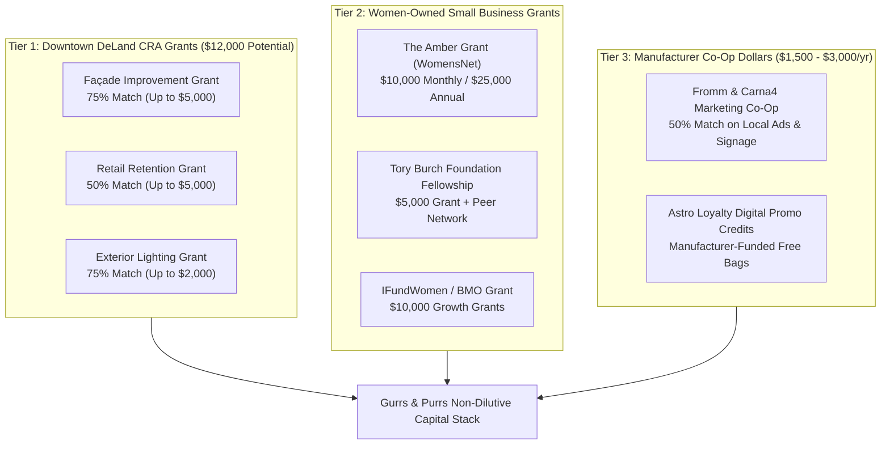

# Gurrs & Purrs · Grants, Funding & Co-Op Subsidies Playbook
**Prepared For:** Rhonda Hobbs & Kelly Hobbs  
**Business:** Gurrs & Purrs (116 N Woodland Blvd & 319 S Woodland Blvd, DeLand, FL)  
**Classification:** Independent Brick-and-Mortar Retail & Service, Woman-Owned Small Business (WOSB)  
**Date:** October 3, 2026  

---

## Executive Summary: Capital Opportunities for Gurrs & Purrs

Gurrs & Purrs qualifies for four distinct tiers of non-dilutive grant capital, municipal redevelopment subsidies, and manufacturer co-op marketing dollars. Because the downtown store is located within the **Downtown DeLand Community Redevelopment Agency (CRA) district**, and because Rhonda Hobbs is a female founder with a 20-year operating legacy, the business has immediate access to matching grants and vendor subsidies that most business owners leave on the table.

---

## Tier 1: City of DeLand & MainStreet DeLand CRA Grants

Gurrs & Purrs' downtown flagship at **116 N Woodland Blvd** is situated directly in the downtown Tax Increment District. The **MainStreet DeLand Association** (located literally next door at 100 N Woodland Blvd, Suite 4) administers these grants on behalf of the DeLand CRA.

### 1. Façade Improvement Matching Grant
* **Grant Value:** Up to **75% matching funds**, capped at **$5,000**.
* **Eligible Projects:**
  * Historic storefront rehabilitation and exterior repainting.
  * New exterior storefront blade signage, gold-leaf window lettering, and awnings.
  * Window display upgrades visible from the Woodland Blvd sidewalk.
* **Why Gurrs & Purrs Qualifies:** 116 N Woodland Blvd is a historic commercial building in the CRA core. Updating signage or awnings celebrating "20 Years of Trusted Pet Care" qualifies directly.
* **Key Rule:** Work must not begin before approval by the MainStreet DeLand Design Review Committee and CRA board.

### 2. Retail Creation & Retention Grant
* **Grant Value:** Up to **50% matching funds**, capped at **$5,000**.
* **Eligible Uses:** Designed specifically to retain essential retail and boutique merchants in the downtown corridor.
* **Why Gurrs & Purrs Qualifies:** As a 20-year anchor retail destination that brings daily pet-owning foot traffic into Downtown DeLand, Gurrs & Purrs is the archetype of retail retention.

### 3. Exterior Storefront & Rear Lighting Grant
* **Grant Value:** Up to **75% matching funds**, capped at **$2,000**.
* **Eligible Uses:** Installing high-efficiency, historically appropriate gooseneck lighting over front awnings, signs, or rear customer entry doors.

**Local Contact:**  
MainStreet DeLand Association  
100 N. Woodland Boulevard, Suite 4, DeLand, FL 32720  
Phone: (386) 738-0649 · Website: [MainStreetDeLand.org](https://mainstreetdeland.org)

---

## Tier 2: Women-Owned Small Business (WOSB) Grants

Rhonda Hobbs qualifies as a woman entrepreneur and founder. Unlike loans, these grants require no repayment and take zero equity.

### 1. The Amber Grant for Women (WomensNet)
* **Grant Amount:** **$10,000 awarded every single month**, plus an additional **$25,000 year-end grant**.
* **Pet Industry Track:** WomensNet frequently awards category grants to pet care, animal wellness, and boutique grooming businesses.
* **Application Requirement:** Short, 2-paragraph essay explaining why you started Gurrs & Purrs, how you've served DeLand for 20 years, and how \$10,000 will be used (e.g., funding the cage-free expansion or Thera-Clean hydrotherapy technology).
* **Website:** [ambergrantsforwomen.com](https://ambergrantsforwomen.com/)

### 2. Tory Burch Foundation Fellows Program
* **Grant Amount:** **$5,000 grant** for business education + premier national cohort of women business owners.
* **Requirements:** 51%+ woman-owned, for-profit business operating for over 1 year with revenue over \$75,000. Gurrs & Purrs' 20-year track record makes this a stellar fit.
* **Website:** [toryburchfoundation.org](https://www.toryburchfoundation.org/)

### 3. IFundWomen Universal Grant Pool
* **Grant Amount:** \$5,000 to \$25,000 from corporate partners (American Express, Visa, Caress).
* **How It Works:** Submit one universal application; when partner grant programs launch, your application is automatically considered.
* **Website:** [ifundwomen.com](https://ifundwomen.com/)

---

## Tier 3: Manufacturer Co-Op Marketing Funds (The "Free Vendor Money")

Most independent pet store owners leave thousands of dollars in **Manufacturer Co-Op Advertising Funds** unspent every year. Brands like **Fromm Family Foods, Carna4, Answers Pet Food, and Steve's Real Food** set aside marketing co-op allowances for authorized independent retailers.

### How Co-Op Dollars Work:
1. **The Allowance:** Premium brands typically provide **2% to 5% of your annual wholesale purchases** back as a marketing reimbursement credit.
2. **The 50% Match:** If Gurrs & Purrs spends \$500 running local Meta/Facebook ads promoting Fromm or Carna4, the manufacturer reimburses **\$250 directly onto your distributor invoice**.
3. **Eligible Media:**
   * Local newspaper / DeLand magazine ads.
   * Social media video advertising (Meta Reels / Instagram ads targeting Volusia County).
   * In-store branded signage, window wraps, or banner sponsorships at the Doggie Derby.
   * Direct mail postcards promoting local delivery and Astro Loyalty.

**Action Item:** Call your distributor sales reps (e.g., Southeast Pet, ADM, or Central Garden & Pet) and request Gurrs & Purrs' **Current Accrued Co-Op Balance Report**.

---

## Tier 4: Volusia County & State of Florida Resources

### 1. Florida SBDC at Daytona State College
The Florida Small Business Development Center (SBDC) provides **100% free, confidential business consulting** to help small businesses apply for state microloans and competitive grants.
* **Contact:** Trecia Arrington, Center Director
* **Phone:** (386) 506-3317 · **Email:** `Trecia.Arrington@DaytonaState.edu`
* **Address:** 1200 W. International Speedway Blvd, Daytona Beach, FL
* **Assistance Provided:** Preparing grant applications, reviewing financial statements, and navigating State of Florida emergency bridge funding.

### 2. Volusia Business Resources (VBR) "Funding Readiness"
A local partnership between the Volusia County Economic Development Division and municipal chambers providing free pitch clinics and grant readiness workshops.
* **Website:** [VolusiaBusinessResources.com](https://www.volusiabusinessresources.com/)

---

## 30-Day Grant Execution Checklist for Rhonda

| Day | Action Item | Target Opportunity | Expected Outcome |
| :---: | :--- | :--- | :--- |
| **Day 1** | Walk into MainStreet DeLand (100 N Woodland) and request the Façade & Retail Grant guidelines. | DeLand CRA | Access up to \$10,000 in local matching funds. |
| **Day 3** | Call your pet food distributor reps and request the Co-Op Advertising Balance report. | Fromm / Carna4 Co-Op | Discover \$1,000–\$3,000 in manufacturer marketing credits. |
| **Day 7** | Submit the 2-paragraph story application for the Amber Grant for Women. | Amber Grant (\$10,000) | Monthly grant review for female founders. |
| **Day 14** | Book a free 30-minute consultation with Trecia Arrington at Florida SBDC Daytona State College. | Florida SBDC | Free professional review of store expansion plans. |
