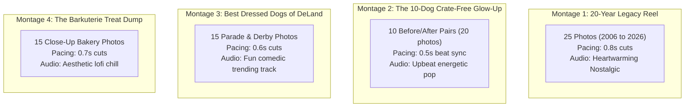

# Gurrs & Purrs · Social Media Content Montage Playbook
**Strategy:** Repurposing 20 Years of Facebook & Instagram Photo Archives into Viral Short-Form Video Montages  
**Platforms:** Instagram Reels, Facebook Reels, TikTok  
**Prepared For:** Rhonda Hobbs & The Gurrs & Purrs Team  
**Date:** October 3, 2026  

---

## 1. Why the "Photo Montage" is Rhonda's Secret Weapon

Rhonda does **not** need to stand in front of a camera or film brand new video footage every day to get 10,000+ views. 

Over the last 20 years, Gurrs & Purrs has posted hundreds of incredible photos to Facebook and Instagram—customer puppies, dramatic grooming haircuts, Mardi Gras dog parades, Earl Brown Park Doggie Derbies, and fresh bakery cases. As single static photos, they reach only ~5% of existing followers.

**When you stitch 15 to 25 of those exact photos into a fast-paced 0.5s–0.8s "Photo Montage Reel" synced to trending music:**
1. **The Algorithm Loves It:** Fast visual cuts create an addictive sensory rhythm. Viewers loop the video 2 to 3 times to inspect all the cute dogs, signaling high watch time to the algorithm.
2. **Zero Filming Barrier:** You can create an entire week’s worth of viral Reels sitting on the couch in 10 minutes using the photos already saved on your phone.
3. **Emotional Resonance:** Showing 20 years of real DeLand pets creates deep community pride that PetSmart and Petco can never duplicate.

---

## 2. Four Turnkey Montage Blueprints (Ready to Assemble)

---

### Montage #1: "20 Years of DeLand Wagging Tails" (The Legacy Anthem)
* **Goal:** Brand authority, emotional connection, and celebration of the 20th anniversary.
* **Photo Selection:** 20 to 25 photos from your Facebook albums:
  * 3 historical photos of the original downtown shop (2006 era).
  * 15 photos of happy dogs over the years with Rhonda, Kelly, and the team.
  * 4 photos of store events and rescue partnerships.
  * Final slide: A current photo of the team outside 116 N Woodland Blvd.
* **Music / Audio:** Heartwarming acoustic or trending nostalgic instrumental (e.g., *“Here Comes the Sun” acoustic instrumental* or *“Golden Hour” piano cover*).
* **Pacing:** 0.8 seconds per photo (Total video length: ~20 seconds).
* **Text Hook Overlay (First 3 seconds):**  
  `"20 years of wagging tails in Downtown DeLand... Here’s 20 seconds of pure joy 🐾"`
* **Ending Text Slide:**  
  `"Thank you DeLand for 20 unforgettable years! — Rhonda & Kelly Hobbs"`
* **Caption & Hashtags:**
  > *"From our first puppy customer in 2006 to today, our hearts are completely full. 20 years of holistic nutrition, 20 years of wagging tails, and 20 years of love from the DeLand community. Thank you for trusting us with your four-legged family members for two decades! 🐶❤️*  
  > *Drop a photo of your pup in the comments if you’ve ever stopped by Gurrs & Purrs!*  
  > *#GurrsAndPurrs #DeLandFL #DowntownDeLand #DeLandDogs #20YearAnniversary #ShopLocalDeLand #StetsonDogs"*

---

### Montage #2: "10 Dogs Who Needed a Crate-Free Spa Day" (The Rapid Glow-Up)
* **Goal:** Fill the grooming appointment calendar at 319 S Woodland Blvd.
* **Photo Selection:** 10 "Before & After" photo pairs (20 photos total) from your grooming archives:
  * Pair 1–10: Scruffy, shaggy dog on arrival ➡️ Fluffy, perfectly sculpted dog with cute bandana post-groom.
* **Music / Audio:** Fast-paced, rhythmic trending audio with strong downbeats (e.g., trending CapCut beat-sync sounds).
* **Pacing:** 0.5 seconds per photo. The transition from "Before" to "After" hits exactly on the musical beat drop!
* **Text Hook Overlay:**  
  `"Proof that a 1-on-1 cage-free spa day changes everything ✨"`
* **Call to Action on Screen:**  
  `"Zero Crates. Zero Stress. Comment GROOM to book!"`
* **Caption & Hashtags:**
  > *"No crates. No cage dryers. Just 1-on-1 gentle hands and restorative hydrotherapy baths. Look at the confidence in their eyes in the 'after' photos! ✨*  
  > *Want your dog to experience grooming without the anxiety of commercial salons?*  
  > *👉 Comment **GROOM** below and we’ll DM you our private booking link!*  
  > *#DeLandDogGrooming #CageFreeGrooming #DoggieGlowUp #DeLandFL #VolusiaCountyDogs #StressFreeGrooming #GurrsAndPurrs"*

---

### Montage #3: "The Best Dressed Dogs of DeLand" (Parade & Derby Hall of Fame)
* **Goal:** High virality, community shares, and local pride.
* **Photo Selection:** 15 to 18 photos from:
  * The Krewe of Amalee Mardi Gras Dog Parade in Downtown DeLand.
  * The West Volusia Kiwanis Club Doggie Derby at Earl Brown Park.
  * Costumed dogs in crowns, tutus, sports jerseys, and superhero capes.
* **Music / Audio:** Upbeat, humorous trending track (e.g., *“Born to be Wild”* or trending comedy sound: *“Are you ready for this?”*).
* **Pacing:** 0.6 seconds per photo.
* **Text Hook Overlay:**  
  `"Nobody dresses up their dogs quite like Downtown DeLand does 👑🐾"`
* **Caption & Hashtags:**
  > *"Every year at the Mardi Gras Parade and Doggie Derby, DeLand pet parents understand the assignment! 🎭🏆 Here are some of our all-time favorite costumed customers.*  
  > *Which one is winning Best in Show in your book? 1, 2, 3, or 4?*  
  > *#DeLandMardiGras #DoggieDerby #DeLandFL #DowntownDeLand #KreweOfAmalee #EarlBrownPark #DogCostumes #VolusiaCounty"*

---

### Montage #4: "The Saturday Morning Barkuterie Case ASMR Dump"
* **Goal:** Drive weekend foot traffic to 116 N Woodland Blvd.
* **Photo Selection:** 12 to 15 mouth-watering close-up shots of:
  * Frosted peanut butter pupcakes.
  * Bacon-dipped cannolis.
  * All-natural beef tracheas and duck necks.
  * Bottles of frothy Answers raw goat milk and bone broths.
* **Music / Audio:** Aesthetic, relaxing lofi hip hop beat.
* **Pacing:** 0.7 seconds per photo.
* **Text Hook Overlay:**  
  `"Everything our dogs convinced us to stock for Saturday morning in DeLand 🥐🤤"`
* **Caption & Hashtags:**
  > *"Your Saturday morning routine: Stroll Downtown DeLand, grab a coffee, and treat your best friend to fresh artisanal barkuterie at Gurrs & Purrs! 🥐🐾*  
  > *100% human-grade, dog-safe peanut butter pupcakes, grain-free cookies, and raw goat milk toppers in stock all weekend at 116 N Woodland Blvd.*  
  > *Which treat would your pup pick?*  
  > *#DogBakery #DowntownDeLand #DeLandFL #DogTreats #Barkuterie #ShopSmallDeLand #GurrsAndPurrs"*

---

## 3. How to Assemble a Montage in Under 3 Minutes (On Rhonda's Phone)

### Option A: Using the Instagram App (Easiest)
1. Open Instagram, tap the **`+`** icon, and select **Reel**.
2. Tap the camera roll icon in the bottom-left corner and tap **"Select Multiple"**.
3. Select 15 to 20 photos from your phone.
4. Tap **Next**. Instagram will automatically suggest trending music synced to your photos!
5. Add the text hook (e.g., *"20 Years of Wagging Tails in DeLand"*).
6. Paste the pre-written caption from this playbook and tap **Share**!

### Option B: Using CapCut (Free Template Mode)
1. Open the free **CapCut** app on your iPhone.
2. In the search bar, type: *"Pet Photo Dump Beat Sync"*.
3. Pick a template you like and tap **"Use Template"**.
4. Tap the 15 photos in your camera roll. CapCut automatically cuts each photo to the drumbeats of the song!
5. Export and share directly to Instagram Reels and TikTok.
